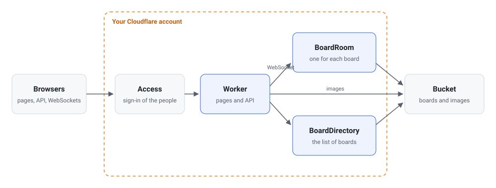

<h1 align="center">
  <picture>
    <source media="(prefers-color-scheme: dark)" srcset="images/alcyone-icon-dark.svg">
    
  </picture>
  <br>
  alcyone
</h1>

<p align="center">A whiteboard for your team that runs on Cloudflare Workers and keeps every board in your S3-compatible bucket.</p>

<p align="center">
  <a href="https://github.com/etak64n/alcyone/actions/workflows/ci.yml"></a>
  <a href="https://github.com/etak64n/alcyone/releases"></a>
  <a href="https://github.com/etak64n/alcyone/blob/main/LICENSE"></a>
</p>

<p align="center">
  <a href="https://etak64n.github.io/alcyone/">Docs</a>
  · <a href="#quickstart">Quickstart</a>
  · <a href="https://github.com/etak64n/alcyone/releases">Releases</a>
  · <a href="https://github.com/etak64n/alcyone/issues">Issues</a>
</p>

The people you allow sign in with Cloudflare Access and work on boards together: sticky notes, text, shapes, lines that join them, pen strokes, and images. Everyone on a board sees the edits and the pointers of the others as they happen. Each board is one JSON file in your bucket, with its images beside it, so your boards stay readable without alcyone.

## Features

### Edit Together

Everyone on a board edits it at once. A note that someone writes, a shape that someone drags, and a line that someone draws show on every screen while it happens, with the pointer and the name of each person.

### Notes, Shapes, Lines, and Drawings

Sticky notes fit their text as it grows, in Japanese too. Rectangles, ellipses, and diamonds hold text of their own. A line joins two items and follows them when they move. The pen draws freehand strokes, and an image comes in by a drop, a paste, or the toolbar.

### Your Bucket Keeps Everything

alcyone needs no database. The list of boards, every board, and every image are files in one bucket at any S3-compatible provider, which you can read, back up, and move as you like.

## Architecture



`pnpm stack:deploy` creates two resources as one stack.

| Resource | Role |
| --- | --- |
| **Access application** | Allows only the people with the configured email addresses, and shows the configured login methods on the sign-in page. |
| **Worker** | Serves the browser app and the API on your domain. Its Durable Objects hold each board while people edit it, and the list of boards, and save them to the bucket. |

The bucket stays outside the stack, because it can be at any S3-compatible provider.

## Quickstart

To try alcyone on your machine without a Cloudflare account or a bucket, see [Try it locally](https://etak64n.github.io/alcyone/getting-started/try-locally/).

### Prerequisites

| Requirement | Details |
| --- | --- |
| **Cloudflare account** | Holds the zone of your domain. |
| **Zero Trust organization** | In that Cloudflare account; runs the sign-in of Cloudflare Access. |
| **S3-compatible bucket** | Supports Signature Version 4. alcyone keeps the boards and their images in it. |
| **Access key** | Has permission to read, write, list, and delete objects in that bucket only. |
| **Node.js** | 22.23+, 24.22+, or 26.12+. |
| **pnpm** | 12.16+. |

### 1. Clone and Install

Clone the repository, check out the `latest` release tag, and install the dependencies.

```bash
# Clone the repository, switch to the latest release, and install the dependencies
git clone https://github.com/etak64n/alcyone.git
cd alcyone
git checkout latest
pnpm install
```

### 2. Configure

Copy `alcyone.config.example.ts` to `alcyone.config.ts` and replace every value.

```bash
# Create your settings from the example. Git ignores alcyone.config.ts.
cp alcyone.config.example.ts alcyone.config.ts
```

This is `alcyone.config.example.ts`:

```ts
// Settings of this alcyone deployment.
//
// Copy this file to alcyone.config.ts and replace every value. Git ignores
// alcyone.config.ts. Storage access keys are secrets, so they do not go here:
// see .env.example.

import { defineAlcyoneConfig } from "./config/settings.ts";

export default defineAlcyoneConfig({
  // Cloudflare account that owns the Worker and the domain
  accountId: "0123456789abcdef0123456789abcdef",
  workerName: "alcyone",
  // People who can rename and delete every board, by the email that Cloudflare Access
  // reports. Everyone else renames and deletes only the boards that they created.
  admins: ["admin@example.com"],
  production: {
    domain: "boards.example.com",
    // The bucket that holds the boards and their images
    storage: {
      type: "s3",
      endpoint: "https://s3.example.com",
      region: "us-east-1",
      bucket: "alcyone-boards",
      urlStyle: "path",
    },
    // Cloudflare Access, which lets only these people open alcyone. pnpm stack:deploy
    // reads the team domain from the Zero Trust organization of the account.
    access: {
      // The emails that may sign in. They include every admin.
      allow: ["admin@example.com"],
      // The login methods that the sign-in page offers: "all" for every login method of your
      // Zero Trust organization, or a list of their types, such as ["passkeys", "onetimepin"]
      loginMethods: "all",
    },
  },
  // `cf dev` serves alcyone on localhost without Cloudflare Access.
  // "local-r2" keeps boards in a simulated R2 bucket on this machine and needs
  // no keys. To develop against real storage, write an "s3" storage here as in
  // production, with a bucket that holds no production boards.
  development: {
    // Cloudflare Access does not run on this machine, so cf dev signs you in as this email.
    signInAs: "admin@example.com",
    storage: {
      type: "local-r2",
    },
  },
});
```

See [Configuration](https://etak64n.github.io/alcyone/settings/configuration/) for every setting.

### 3. Add the Keys of the Bucket

Copy `.env.example` to `.env.production` and fill in the access key of the bucket.

```bash
# Git ignores .env.production. pnpm stack:deploy uploads the keys to the Worker as secrets.
cp .env.example .env.production
```

### 4. Deploy

Sign in to Cloudflare, then create the stack.

```bash
# Sign in to Cloudflare in the browser
pnpm exec cf auth login

# Check the keys against the bucket, then create the Access application and the Worker
pnpm stack:deploy
```

Open your domain, sign in, and create a board.

## Updating and Uninstalling

Before you update, check the [release notes](https://github.com/etak64n/alcyone/releases). Then deploy the new release.

```bash
# Switch to the latest release, install its dependencies, and deploy it
git fetch --tags --force
git checkout latest
pnpm install
pnpm stack:deploy
```

To uninstall, delete the stack. The boards and their images stay in your bucket.

```bash
# List the resources of the stack, and delete them after you type the name of the stack
pnpm stack:delete
```

## License

[MIT](LICENSE)
